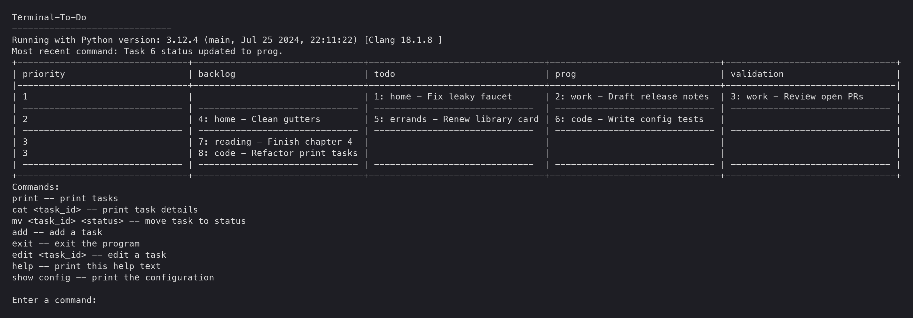

# Terminal_To_Do

A small kanban-style task board that runs in the terminal. Tasks live in a
SQLite database, are shown as a table of priority rows by status columns, and
are added, moved and edited with short typed commands. The database file is
pulled from an S3-compatible bucket (such as MinIO) when the app starts and
pushed back when it exits, so the same board can be used from several
machines.

It exists to keep a personal to-do list in a plain terminal, with no web app
or account, while still syncing between computers.



## How it works

`src/main.py` is the whole app. One run does this:

1. Loads the config (see [Configuration](#configuration)) and prints it.
2. Makes sure the bucket `terminal-to-do` exists, then downloads `tasks.db`
   from it to `data/tasks.db`. If the download fails, it asks what to do:
   retry, use the existing local `data/tasks.db` (only offered when there is
   one), start a new empty task list (only when there is no local copy), or
   quit without touching the bucket. Whatever is opened is uploaded over the
   bucket copy on exit, so this is never decided silently.
3. Opens `data/tasks.db`, creating the file and the `tasks` table if needed:
   `id`, `priority` (integer, default 0), `category`, `title`, `description`,
   `status`.
4. Loops: clears the screen, prints the board and the command list, reads one
   command.
5. On `exit`: writes `data/tasks_backup_most_recent.csv` and a dated copy in
   `data/archive/tasks_backup_YYYY-MM-DD.csv`, then uploads `tasks.db` back to
   the bucket, retrying every 5 seconds until it succeeds.

The board groups tasks by priority (lowest number first) into rows and by
status into columns. Each cell shows `id: category - title`. Statuses are
free text; any status not listed in the config still gets a column.

Sync is whole-file: the last machine to exit overwrites the bucket copy, so
running it on two machines at once loses the first one's changes.
`POSTGRES_MIGRATION_PLAN.md` describes a planned move to Postgres to fix this.

## Commands

Commands are case-insensitive.

| Command | Action |
| --- | --- |
| `print` | Print the board |
| `cat <task_id>` | Print one task's details |
| `mv <task_id> <status>` | Move a task to a status |
| `add` | Add a task (prompts; priority defaults to 2, status to `backlog`) |
| `edit <task_id>` | Edit a task (prompts; Enter keeps the current value) |
| `help` | Print the command list |
| `show config` | Print the loaded configuration |
| `exit` | Back up, upload and quit |

## Configuration

On first run the app copies `terminal_to_do_config_defaults.json` to the user
config file and uses that from then on. Keys missing from the user file are
filled from the defaults.

- Linux and macOS: `~/.config/terminal_to_do/terminal_to_do_config.json`
- Windows: `%APPDATA%\terminal_to_do\terminal_to_do_config.json`

Defaults:

```json
{
  "swim_lanes": ["priority", "backlog", "todo", "prog", "validation"],
  "hide_cols": ["done"]
}
```

- `swim_lanes`: column order on the board. Other statuses follow after these.
- `hide_cols`: statuses that are not shown on the board.

Storage credentials come from a `.env` file in the repo root, read by the
`readable-utils` S3 helpers:

```bash
S3_ENDPOINT=http://localhost:9000
MINIO_ROOT_USER=...
MINIO_ROOT_PASSWORD=...
```

## Running

Requires Python 3.12 or 3.13. Dependencies are declared in `pyproject.toml`
and locked in `uv.lock`; `readable-utils` is installed from its GitHub tag.

```bash
uv sync
uv run python src/main.py
```

Run from the repo root; `data/` is created there and is gitignored.

Tests (`tests/test_utils/test_s3_tools.py`) write to, list and read from a
real bucket, so they need the same `.env`:

```bash
uv run pytest
```

Lint and format with ruff (configured in `pyproject.toml`; installed with the
dev group by `uv sync`):

```bash
uv run ruff check .
uv run ruff format .
```

### Windows pyenv setup

The repo pins Python 3.12.4 in `.python-version`. To get that version on
Windows with pyenv:

- Use Chocolatey to install pyenv-win

```bash
choco install pyenv-win
```

- Install python 3.12

```bash
pyenv install 3.12.4
```

- Switch to this version of python globally

```bash
pyenv global 3.12.4
```

- Switch to this version of python locally

```bash
pyenv local 3.12.4
```

- Activate shell with pyenv

```bash
pyenv shell 3.12.4
```

- Install dependencies into this version of python. Older versions of this
  repo used `python3 -m pip install -r requirements.txt`; that file no longer
  exists, so use `uv sync` as above.

## Layout

- `src/main.py`: the app (config, SQLite access, board rendering, command loop, S3 sync).
- `terminal_to_do_config_defaults.json`: default board config.
- `POSTGRES_MIGRATION_PLAN.md`: plan for replacing the SQLite file sync.
- `docs/screenshots/`: README images, made from fake sample data.
